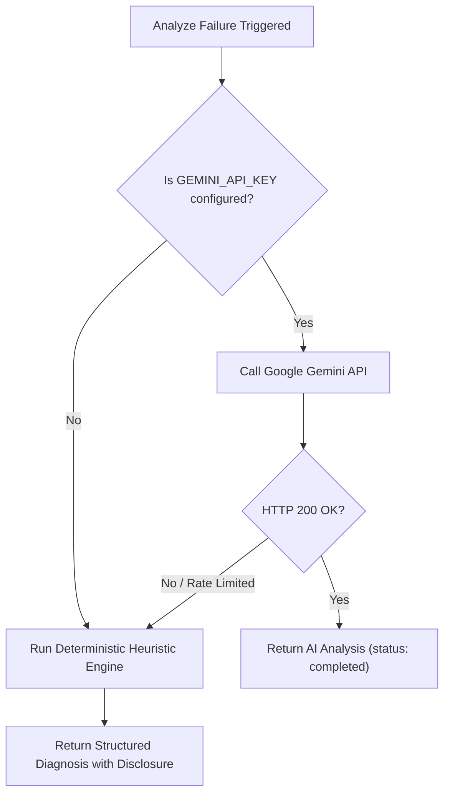

# TestForge — AI Failure Analysis Specification (Day 29–30)

The **TestForge AI Failure Analysis Engine** provides automated, intelligent root-cause diagnosis for failed test execution runs. It analyzes Playwright worker logs, step traces, locators, and screenshots to explain *why* a test failed and how to resolve it—without requiring engineers to sift through raw console outputs.

---

## 1. Security & Data Sanitization (`sanitizeValue`)

Before any failure context is transmitted to an external AI model, TestForge executes a strict server-side sanitization pipeline to redact credentials, secrets, tokens, and personally identifiable information:

```javascript
import { sanitizeFailureContext } from '../services/aiService.js';
```

### Redaction Rules & Patterns

| Sensitive Data Type | Pattern Detected | Redacted Output |
|---|---|---|
| **JSON Web Tokens (JWT)** | `eyJ[A-Za-z0-9-_=]+\.[A-Za-z0-9-_=]+\.?...` | `<REDACTED_JWT>` |
| **Authorization Bearer Header** | `Authorization:\s*Bearer\s+[^\s"'\n]+` | `Authorization: Bearer <REDACTED>` |
| **Passwords / Secrets (Query / Form)** | `(password\|secret\|apiKey\|token)=...` | `$1=<REDACTED>` |
| **Passwords / Secrets (JSON Fields)** | `"password": "..."`, `"secret": "..."` | `"$1": "<REDACTED>"` |
| **Google Gemini API Keys** | `AIzaSy[A-Za-z0-9-_]{35}` | `<REDACTED_API_KEY>` |
| **OpenAI / Secret API Keys** | `sk-[A-Za-z0-9]{32,}` | `<REDACTED_API_KEY>` |

*Recursive sanitization applies across strings, arrays, and deeply nested objects. Key names containing `password`, `secret`, `token`, `apikey`, `auth`, or `jwt` are completely masked.*

---

## 2. Gemini AI Integration & Model Fallback

TestForge communicates with Google's Generative Language API using low temperature (`0.2`) to ensure factual, deterministic analysis:

### Configuration

In `apps/server/.env`:

```env
GEMINI_API_KEY=your_gemini_api_key_here
GEMINI_MODEL=gemini-2.5-flash
```

### Automatic Model Fallback

1. **Primary Call**: Calls the configured model (defaults to `gemini-2.5-flash`).
2. **Model Retries**: If the endpoint returns HTTP 404 (model not found or region unsupported), it gracefully retries with `gemini-1.5-flash`.
3. **Guaranteed JSON Output**: The API request specifies `responseMimeType: "application/json"` to ensure structured JSON output.

---

## 3. Structured Output JSON Schema

The diagnosis returned by the AI engine adheres to this structured schema:

```json
{
  "summary": "Clear concise 1-2 sentence overview of what failed",
  "failedStep": "Step number, step type, and description of the failed step",
  "observedError": "Exact error message or assertion failure observed",
  "likelyCause": "Likely technical cause based on evidence",
  "evidence": [
    "Execution stopped at Step 2 (click)",
    "Observed error: locator.click: Timeout 5000ms exceeded"
  ],
  "suggestedInvestigation": [
    "Check whether the element selector matches an existing element in the DOM.",
    "Verify if the button requires a previous user action or transition to become clickable."
  ],
  "possibleFix": [
    "Update the locator to a more stable selector (e.g. data-testid or accessible role).",
    "Increase the step timeout or add an explicit wait before clicking."
  ],
  "uncertainty": "Any ambiguity or missing evidence explanation"
}
```

### Safety Principles

1. **No Automated Code Modification**: The engine does NOT modify test scripts or commit code autonomously. It delivers actionable recommendations for human engineers to review.
2. **Evidence-Based Reasoning**: The assistant reasons strictly over observed execution logs, step definitions, and screenshots without hallucinating unstated DOM elements.

---

## 4. Deterministic Playwright Heuristic Diagnostic Fallback

If the external Gemini AI service is unavailable (e.g., missing API key, rate limit HTTP 429, or network failure), TestForge automatically activates its **Deterministic Playwright Heuristic Diagnostic Engine** (`generatePlaywrightHeuristicAnalysis`):



### Heuristic Detection Patterns

1. **Locator Wait Timeout**:
   - *Regex*: `/timeout.*exceeded/i`, `/waiting for locator/i`
   - *Diagnosis*: Identifies that the target element was not found in the DOM or did not become actionable within the timeout. Recommends checking element selector stability, role attributes, or preceding transitions.
2. **Strict Mode Violation (Multiple Elements Match)**:
   - *Regex*: `/strict mode violation/i`, `/resolved to \d+ elements/i`
   - *Diagnosis*: Explains that Playwright requires a unique locator, but multiple DOM elements matched the query. Recommends scoping the selector or adding index/hierarchy qualifiers.
3. **Assertion / Expect Failure**:
   - *Regex*: `/expect\(.*\)/i`, `/toHaveText/i`, `/toBeVisible/i`
   - *Diagnosis*: Detects that the actual DOM text or visibility state contradicted the expected test assertion. Recommends verifying recent UI copy changes.
4. **Navigation / Network Failure**:
   - *Regex*: `/net::ERR_/i`, `/failed to load/i`, `/navigation/i`
   - *Diagnosis*: Detects that the browser failed to reach the server. Recommends checking base URL configuration, firewalls, and server uptime.

---

## 5. API Endpoints

### 1. Trigger Failure Analysis

```http
POST /api/runs/:id/analyze
Authorization: Bearer <token>
```

- **Preconditions**:
  - Run ID must be a valid MongoDB ObjectId.
  - Run must belong to the authenticated user (`403 Forbidden` if owned by another user).
  - Run status must be `'failed'` (`400 Bad Request` if run passed or is still running).
- **Caching**: If analysis was previously completed and `force` is not set, the cached analysis is returned immediately without re-invoking external AI.

### 2. Force Re-Analysis

```http
POST /api/runs/:id/analyze?force=true
Authorization: Bearer <token>
```

- Bypasses the cached analysis and triggers a fresh diagnosis across updated execution logs.

---

## 6. Frontend UI Integration (`RunDetailModal.tsx`)

The analysis results are embedded directly into the execution run details modal:

- **State 1 (Not Analyzed)**: Displays prompt: *"Click 'Analyze Failure' to generate a structured AI explanation..."*
- **State 2 (Analyzing)**: Displays animated loading spinner with disabled button state: *"Analyzing failure..."*
- **State 3 (Completed)**: Displays structured card view:
  - 🟣 **Summary**
  - 🟡 **Failed Step** & 🔴 **Observed Error**
  - 🔵 **Likely Cause**
  - 🔍 **Key Evidence**
  - 💡 **Suggested Investigation** & 🟢 **Possible Fixes**
  - ❓ **Uncertainty Disclaimer**
  - 🔄 **Re-analyze Button**
- **Dark / Light Mode**: The card and inner diagnostic boxes adapt seamlessly using CSS theme variables (`var(--bg-card)`, `var(--text-primary)`, `var(--border-color)`).
