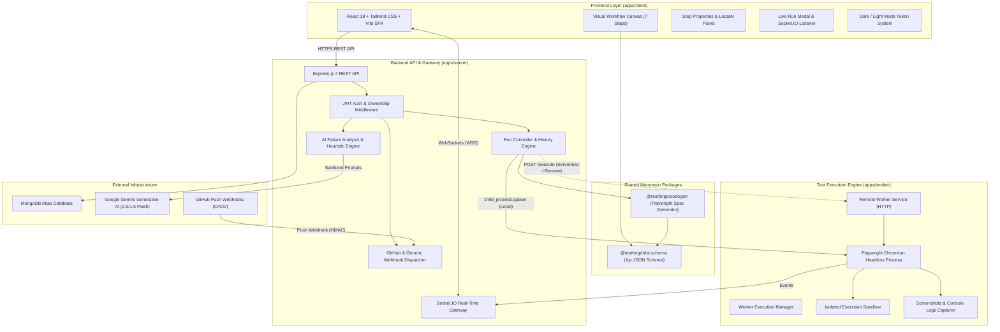
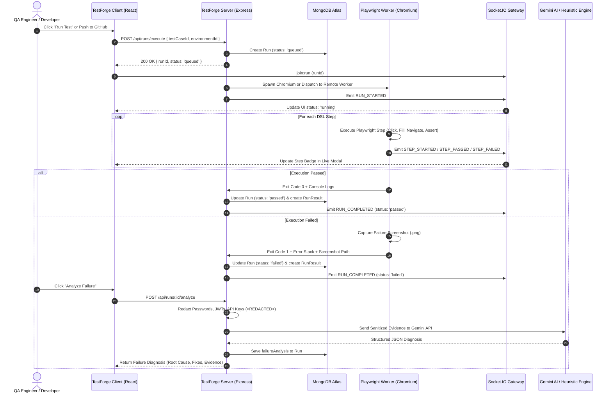
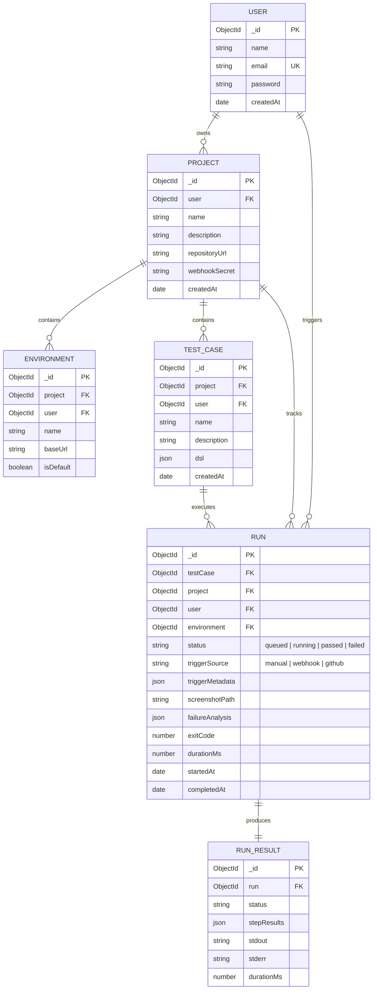

# TestForge — System Architecture Documentation

This document describes the high-level system architecture, component topology, execution pipelines, data models, and security boundaries of the **TestForge** platform.

---

## 1. Architectural Overview

TestForge is designed as a modular npm-workspaces monorepo separating presentation, API routing, code generation, schema validation, test execution, and AI failure diagnostics.



---

## 2. Monorepo Package Topology

```text
testforge/
├── apps/
│   ├── client/               # React 18 SPA (Vite, TypeScript, Tailwind CSS, Lucide)
│   │   ├── src/components/   # Visual Test Builder, Execution Modals, Nav, Dashboards
│   │   ├── src/services/     # Axios API Clients & Socket.IO Listeners
│   │   └── src/types/        # Shared TypeScript interfaces
│   ├── server/               # Express.js REST API + Socket.IO Server
│   │   ├── src/controllers/  # Auth, Project, Environment, TestCase, Run, Webhook
│   │   ├── src/models/       # Mongoose Schemas (User, Project, TestCase, Run, RunResult)
│   │   ├── src/services/     # Execution Service, AI Service, Webhook Service
│   │   └── src/socket/       # Socket.IO Connection & Room Management
│   └── worker/               # Headless Playwright Chromium Execution Worker
│       └── uploads/          # Static failure screenshot storage
├── packages/
│   ├── dsl-schema/           # Ajv JSON Schema validator for TestForge DSL v1.0
│   └── codegen/              # DSL-to-Playwright TypeScript compiler
└── docs/                     # Architecture, DSL spec, codegen, webhooks, and API testing
```

---

## 3. End-to-End Test Execution Pipeline

The execution of a test flow progresses through 7 strictly coordinated stages:



---

## 4. Database Entity-Relationship Model (ERD)



---

## 5. Worker Architecture: Local vs. Serverless & Remote

Playwright requires launching full browser binaries (Chromium, Firefox, WebKit). Because serverless environments (such as Vercel Functions or AWS Lambda) enforce a **read-only filesystem** (except `/tmp`) and do not include bundled browser binaries, TestForge implements a **Hybrid Worker Architecture**:

1. **Local Development & Dedicated Servers**:
   - The server spawns child processes directly via `child_process.spawn`.
   - Temporary test specs are written into isolated run directories (`/scratch/testforge-runs/<runId>`) and cleaned up immediately upon completion.
2. **Serverless (Vercel) Deployment**:
   - When running on Vercel (`process.env.VERCEL === '1'`), the execution service checks for `WORKER_SERVICE_URL`.
   - If `WORKER_SERVICE_URL` is set, the execution request is delegated over HTTP to the dedicated worker instance (running in Docker, Railway, Render, or EC2).
   - If `WORKER_SERVICE_URL` is not set, the server returns an explicit **`503 Service Unavailable`** with code **`WORKER_UNAVAILABLE`**, directing the user to connect a remote worker instead of crashing with an unhandled `ENOENT` error.

---

## 6. AI Failure Diagnostic Architecture

The AI Failure Analysis engine (Day 29–30) provides automated, safe failure explanations:

### 1. Mandatory Data Sanitization (`sanitizeValue`)
Before any data is transmitted to an external AI provider:
- JWT tokens (`eyJ...`) $\rightarrow$ `<REDACTED_JWT>`
- Authorization Bearer tokens $\rightarrow$ `Authorization: Bearer <REDACTED>`
- Password parameters (`password=...`, `"password": "..."`) $\rightarrow$ `password=<REDACTED>`
- API keys (`AIzaSy...`, `sk-...`) $\rightarrow$ `<REDACTED_API_KEY>`

### 2. Dual-Layer AI & Heuristic Fallback
1. **Primary Model**: Calls `gemini-2.5-flash` with low temperature (`0.2`) and strict JSON schema generation.
2. **Model Fallback**: If the primary model returns HTTP 404, the service automatically retries with `gemini-1.5-flash`.
3. **Deterministic Heuristic Engine**: If the Gemini API is unconfigured, rate-limited (HTTP 429), or offline, TestForge activates its built-in Playwright heuristic analyzer to diagnose:
   - Locator wait timeouts
   - Strict mode selector collisions (multiple matching elements)
   - Assertion expectations mismatch (`toHaveText`, `toBeVisible`)
   - Page navigation and network connection errors (`net::ERR_CONNECTION_REFUSED`)

---

## 7. Security & Authorization

- **JWT Authentication**: Signed with HMAC SHA-256 (`JWT_SECRET`), expiring in 7 days by default.
- **Strict User Scoping**: All queries filter by `user: req.user._id`. Cross-user access returns `403 Forbidden` or `404 Not Found`.
- **Webhook HMAC Verification**: Incoming GitHub webhooks verify the `X-Hub-Signature-256` header using constant-time cryptographic comparison (`crypto.timingSafeEqual`) against the project's `webhookSecret`.
- **Delivery Deduplication**: In-flight and recently processed webhook IDs (`X-GitHub-Delivery`) are tracked in memory to prevent duplicate test runs on webhook retries.
