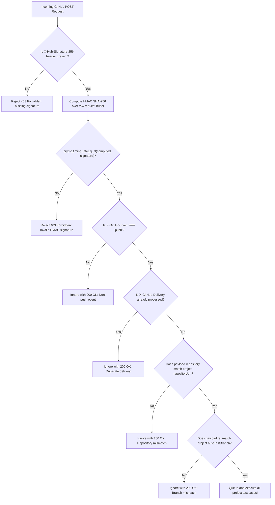

# TestForge — CI/CD Webhooks & Auto-Testing Guide (Day 26–28)

TestForge supports automated test execution triggered directly by **GitHub code pushes** or **Generic CI/CD pipelines** (e.g., GitLab, Bitbucket, Jenkins, GitHub Actions).

When code is committed or a pipeline completes, TestForge automatically executes the project's test suite, captures execution logs and failure screenshots, and records auto-test statistics.

---

## 1. GitHub Push Webhook Integration

### 1.1 Webhook URL & Configuration in GitHub

1. Navigate to your GitHub repository: **Settings** $\rightarrow$ **Webhooks** $\rightarrow$ **Add webhook**.
2. Configure the webhook settings:
   - **Payload URL**: `https://<your-testforge-server>/api/webhooks/github/<projectId>`
     *(Replace `<projectId>` with your TestForge project ID found on the Project Settings page)*
   - **Content type**: `application/json`
   - **Secret**: Enter the **Webhook Secret** configured in your TestForge project settings.
   - **Which events would you like to trigger this webhook?**: Select **Just the `push` event**.
   - **Active**: Ensure the checkbox is checked.
3. Click **Add webhook**.

---

### 1.2 Verification & Security Architecture

GitHub webhooks undergo multi-stage security validation before any tests are queued:



#### Key Security Implementations:
1. **Raw Body HMAC Computation**: Express preserves `req.rawBody` buffer during JSON body parsing to calculate the exact SHA-256 signature without JSON serialization discrepancies.
2. **Timing-Safe Comparison**: Signatures are compared using Node's `crypto.timingSafeEqual` to eliminate timing attacks.
3. **Repository URL Normalization**: Handles GitHub URLs in all common forms:
   - `https://github.com/myorg/myapp`
   - `https://github.com/myorg/myapp.git`
   - `git@github.com:myorg/myapp.git`
4. **Branch Matching**: Normalizes refs (`refs/heads/main` $\rightarrow$ `main`) to match the configured auto-test branch.
5. **Deduplication**: Remembers processed `X-GitHub-Delivery` UUIDs to reject re-delivered webhook payloads.

---

## 2. Generic Webhook Integration

For custom CI/CD pipelines (GitLab, Bitbucket, CircleCI, Jenkins, or curl scripts), use the Generic Webhook endpoint.

### Endpoint

```http
POST /api/webhooks/generic/:projectId
Content-Type: application/json
x-webhook-secret: <your-project-webhook-secret>
```

### Request Body (Optional Metadata)

```json
{
  "branch": "main",
  "commit": "a1b2c3d",
  "repository": "myorg/myapp",
  "author": "dev@example.com"
}
```

### cURL Example

```bash
curl -X POST "https://testforge-server.vercel.app/api/webhooks/generic/6ad5ce09735dd7f4781d513f" \
  -H "Content-Type: application/json" \
  -H "x-webhook-secret: my_super_secret_token_123" \
  -d '{"branch": "main", "commit": "7f8a9b0", "repository": "myorg/my-shop"}'
```

### Response

```json
{
  "success": true,
  "message": "Triggered 3 automated test execution(s)",
  "count": 3,
  "data": [
    {
      "runId": "6ad5ce09986e1aa54a783120",
      "testCaseId": "507f1f77bcf86cd799439013",
      "testCaseName": "Login Flow",
      "status": "queued"
    }
  ]
}
```

---

## 3. Auto-Test Dashboard Metrics (Day 28)

Every execution triggered via GitHub or Generic webhooks records metadata marking `triggerSource: "github"` or `"webhook"`.

The dashboard (`GET /api/runs/stats`) aggregates these into high-visibility CI/CD metrics:

| Metric Key | Description |
|---|---|
| `totalRuns` | Total test execution runs (manual + automated) |
| `passRate` | Overall pass rate percentage across all runs |
| `autoRuns` | Total automated runs triggered via Webhooks / CI/CD |
| `autoPassedRuns` | Number of automated runs that completed with status `passed` |
| `autoFailedRuns` | Number of automated runs that completed with status `failed` |
| `autoPassRate` | Pass rate percentage specifically for automated CI/CD runs |

*These metrics display in the project dashboard, allowing development teams to isolate CI/CD regression trends from exploratory manual test runs.*

---

## 4. Live Reference Implementation (`testforge-e-commerce`)

A live production webhook has been configured and verified for end-to-end testing:

- **Target Repository**: [`https://github.com/VIJAYAPANDIANT/testforge-e-commerce`](https://github.com/VIJAYAPANDIANT/testforge-e-commerce)
- **Settings Path**: GitHub Repository ➔ Settings ➔ Webhooks
- **Configured Payload URL**: `https://testforge-server.vercel.app/api/webhooks/github/6ad38cd009236f514119ac6d`
- **Content Type**: `application/json` *(server also supports `application/x-www-form-urlencoded`)*
- **Active Events**: `push`
- **Delivery Status**: Verified with green checkmark (`200 OK`) and automatic ping handshake.
- **Triggered Test Suite**: Automatically queues and executes the `Navigate` test case in Chromium when commits are pushed to `main`.
